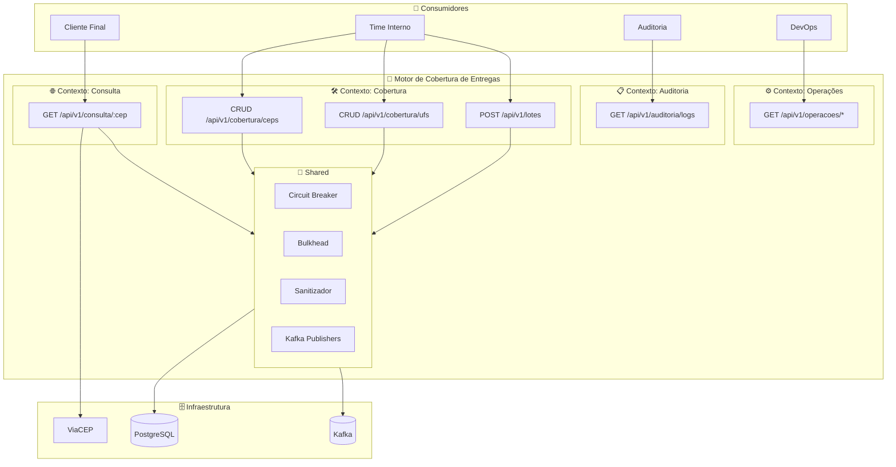
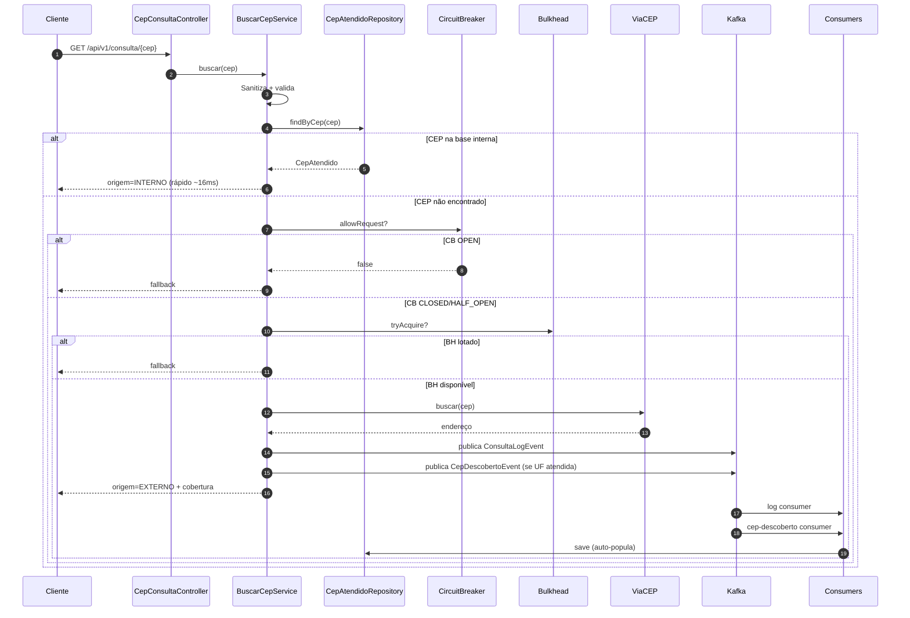

# 🚚 Consulta CEP — Motor de Cobertura de Entregas

> API REST que responde à pergunta: **"Essa loja entrega no meu CEP?"**

Motor de consulta de cobertura de entregas para e-commerce, com priorização de base interna, fallback para API externa (ViaCEP), auditoria assíncrona via Kafka e resiliência de nível de produção.

[](https://openjdk.org/projects/jdk/21/)
[](https://spring.io/projects/spring-boot)
[](https://www.postgresql.org/)
[](https://kafka.apache.org/)
[](https://www.docker.com/)

---

## 📖 Visão Geral

O sistema resolve um problema real de e-commerce: **verificar se um CEP é atendido e com qual prazo/taxa**, sem depender exclusivamente de uma API externa.

### Como funciona

1. **Cliente final** consulta um CEP pelo endpoint público.
2. **Motor de busca** verifica primeiro a **base interna** (CEPs que a loja já cadastrou).
3. Se **não encontrar**, consulta a API externa **ViaCEP**.
4. Verifica se a **UF** é atendida pela loja e retorna prazo + taxa.
5. **Auditoria**: cada consulta externa gera um log via Kafka (assíncrono, sem afetar a resposta).
6. **Auto-população**: CEPs descobertos de UFs atendidas são salvos na base interna automaticamente.

### Por que ele é diferente

| Recurso | Implementação |
|---|---|
| **Priorização interna** | Base local antes de gastar chamada externa |
| **Resiliência** | Circuit Breaker + Bulkhead + Retry + Fallback |
| **Performance** | Cache, paginação, `@Async`, Virtual Threads |
| **Auto-população** | Base interna cresce com o uso real |
| **Processamento em lote** | 1000+ CEPs com Virtual Threads, sem perder dados |
| **Auditoria assíncrona** | Kafka para logs, sem bloquear resposta |

---

## 🛠 Stack Tecnológica

### Backend
- **Java 21** (Virtual Threads, Records, Pattern Matching)
- **Spring Boot 4.1.1**
- **Spring Data JPA** + **Hibernate 7**
- **PostgreSQL 16**
- **Apache Kafka 4.2** (producer + consumer)
- **Flyway** (migrations)
- **Caffeine** (cache em memória)
- **Jackson 3**

### Infraestrutura
- **Docker + Docker Compose**
- **Kafka em modo KRaft** (sem Zookeeper)

### Bibliotecas de suporte
- **Lombok** (produtividade)
- **Bean Validation** (validação)
- **Spring Actuator** (observabilidade)
- **SLF4J + Logback** (logs)

### Testes
- **JUnit 5**
- **Mockito**
- **AssertJ**

---

## 🏗 Arquitetura

O projeto segue uma arquitetura **inspirada em DDD (Domain-Driven Design)** com **4 bounded contexts** + um módulo **shared**.

### Diagrama de Contextos



### Estrutura de Pacotes

```
src/main/java/br/com/cobertura/consulta/
├── ConsultaCepApplication.java
│
├── consulta/                    # Contexto 1 — Consulta (público)
│   ├── api/                     # CepConsultaController
│   ├── application/             # BuscarCepService, DTOs, UseCases
│   └── infrastructure/viacep/   # ViaCepProvider
│
├── cobertura/                   # Contexto 2 — Cobertura (admin)
│   ├── api/                     # Controllers de CEP, UF, Lote
│   ├── application/             # Services, DTOs, UseCases
│   ├── domain/                  # Entidades + Repositórios
│   └── infrastructure/          # Kafka consumers + worker
│
├── auditoria/                   # Contexto 3 — Auditoria
│   ├── api/
│   ├── application/
│   ├── domain/                  # ConsultaLog
│   └── infrastructure/kafka/    # Consumer
│
├── operacoes/                   # Contexto 4 — Operações
│   └── api/                     # Resilience, Cache, Worker
│
└── shared/                      # Código compartilhado
    ├── config/                  # Configs (Kafka, Async, VirtualThreads)
    ├── exception/               # Exceptions + GlobalExceptionHandler
    ├── messaging/               # Publishers Kafka
    ├── model/                   # OrigemConsulta
    ├── port/out/                # Interfaces (CepProvider, Publishers)
    ├── resilience/              # CircuitBreaker, Bulkhead
    └── service/                 # Sanitizador
```

### Diagrama de Fluxo — Consulta de CEP



---

## 🚀 Como Rodar

### Pré-requisitos

- **Docker** e **Docker Compose**
- **Java 21** (apenas se for rodar localmente sem Docker)
- **Maven** (opcional — use `mvnw`)

### Opção 1 — Docker Compose (Recomendado)

```bash
# Clone o repositório
git clone https://github.com/DavidPrado/consulta-cep.git
cd consulta-cep

# Suba tudo (app + PostgreSQL + Kafka)
docker-compose up --build
```

A aplicação estará disponível em `http://localhost:8080`.

**Tempo de inicialização:** ~3 a 5 minutos na primeira execução (build do Maven).

### Opção 2 — Rodar Localmente (Desenvolvimento)

```bash
# 1. Suba apenas a infraestrutura
docker-compose up postgres kafka -d

# 2. Rode a aplicação
./mvnw spring-boot:run

# 3. Acesse
# http://localhost:8088/actuator/health
```

### Verificar se está funcionando

```bash
curl http://localhost:8088/actuator/health
# {"status":"UP"}
```

---

## 🧪 Testes

```bash
./mvnw test
```

A suíte inclui:
- Testes unitários dos Services
- Testes do Sanitizador
- Testes de Controller (`@WebMvcTest`)
- Teste de integração do ViaCEP (`ViaCepProviderIT`)

---

## 📦 Estrutura do Repositório

```
consulta-cep/
├── .github/                     # GitHub Actions (futuro)
├── docs/
│   ├── adr/                     # Architecture Decision Records
│   └── consulta-cep.postman_collection.json
├── src/
│   ├── main/
│   │   ├── java/br/com/cobertura/consulta/
│   │   └── resources/
│   │       ├── application.yml
│   │       ├── application-local.yml
│   │       ├── application-docker.yml
│   │       └── db/migration/
│   └── test/
├── docker-compose.yml
├── Dockerfile
├── pom.xml
└── README.md
```