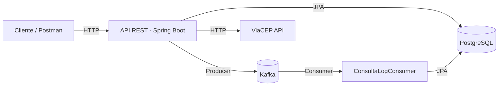
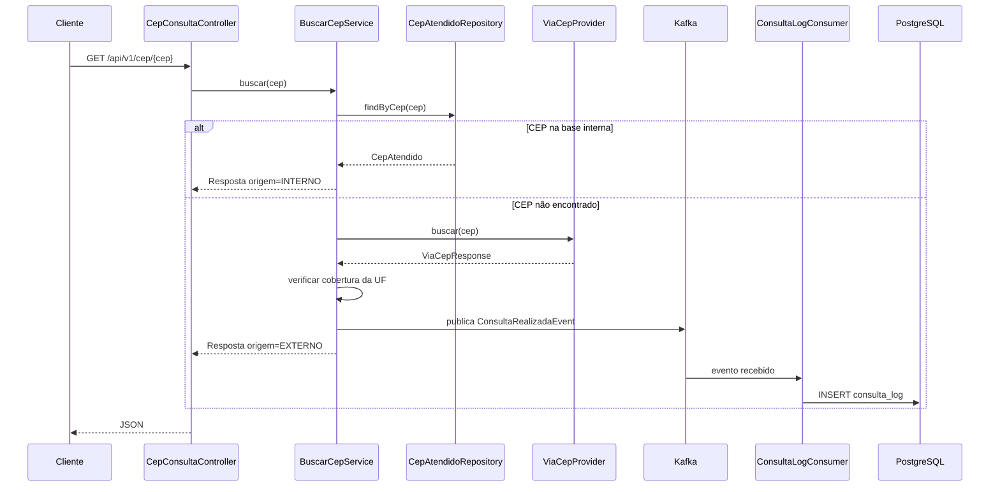
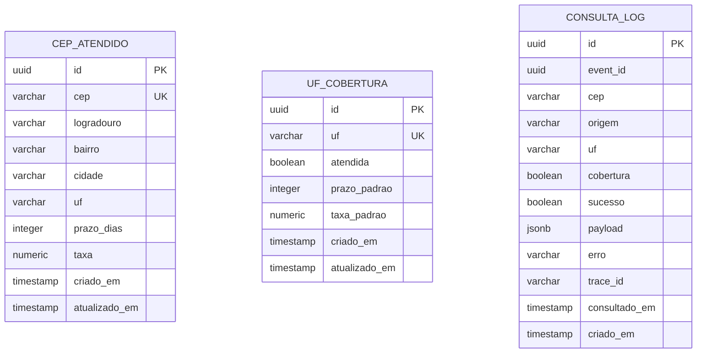
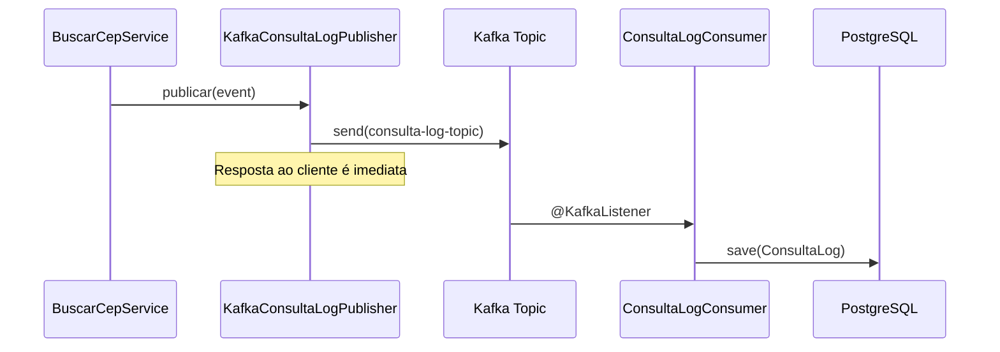

# Consulta CEP — Sistema de Cobertura de Entrega

API REST que consulta CEPs com **priorização interna** e **cobertura por UF**, registrando logs de consulta de forma **assíncrona via Kafka** para não comprometer a performance da resposta.

---

## 📋 Descrição

O sistema permite:

- Cadastrar **CEPs atendidos** com dados próprios (prazo e taxa).
- Cadastrar **UFs atendidas** com prazo e taxa padrão.
- Consultar um CEP: primeiro busca na base interna; se não encontrar, consulta a API externa **ViaCEP** e verifica se a UF é atendida.
- Registrar cada consulta externa de forma **assíncrona** via Kafka, gravando o log no banco sem impactar a resposta ao cliente.

---

## 🛠 Tecnologias

| Tecnologia | Versão |
|---|---|
| Java | 21 |
| Spring Boot | 4.1.1 |
| Spring Data JPA | — |
| Spring Kafka | — |
| PostgreSQL | 16 |
| Apache Kafka | 7.5.0 (Confluent, KRaft) |
| Flyway | — |
| Docker + Docker Compose | — |

---

## 🚀 Como rodar

### Pré-requisitos
- Docker e Docker Compose instalados
- Java 21 (apenas se quiser rodar localmente)

### Subir tudo com Docker

```bash
docker-compose up --build
```

A aplicação ficará disponível em `http://localhost:8080`.

### Rodar localmente (para desenvolvimento)

1. Suba apenas o Postgres e o Kafka:
   ```bash
   docker-compose up postgres kafka -d
   ```
2. Rode a aplicação:
   ```bash
   mvn spring-boot:run
   ```
3. Acesse `http://localhost:8088/actuator/health`.

---

## 🔌 Endpoints

### Cadastro de CEPs atendidos

```http
POST /api/v1/ceps-atendidos
Content-Type: application/json

{
  "cep": "01310100",
  "logradouro": "Avenida Paulista",
  "bairro": "Bela Vista",
  "cidade": "São Paulo",
  "uf": "SP",
  "prazoDias": 2,
  "taxa": 15.90
}
```

```http
GET /api/v1/ceps-atendidos
```

### Cadastro de UFs atendidas

```http
POST /api/v1/ufs-cobertura
Content-Type: application/json

{
  "uf": "SP",
  "atendida": true,
  "prazoPadrao": 3,
  "taxaPadrao": 12.50
}
```

```http
PUT /api/v1/ufs-cobertura/{uf}
```

```http
GET /api/v1/ufs-cobertura
```

### Consulta de CEP

```http
GET /api/v1/cep/{cep}
```

**Exemplo de resposta (origem interna):**
```json
{
  "cep": "01310100",
  "logradouro": "Avenida Paulista",
  "bairro": "Bela Vista",
  "cidade": "São Paulo",
  "uf": "SP",
  "origem": "INTERNO",
  "cobertura": true,
  "prazoDias": 2,
  "taxa": 15.90
}
```

**Exemplo de resposta (origem externa):**
```json
{
  "cep": "20040002",
  "logradouro": "Avenida Rio Branco",
  "complemento": "de 156 a 296 - lado par",
  "bairro": "Centro",
  "cidade": "Rio de Janeiro",
  "uf": "RJ",
  "origem": "EXTERNO",
  "cobertura": true,
  "prazoDias": null,
  "taxa": null
}
```

### Logs de consulta

```http
GET /api/v1/logs
```

---

## 🏗 Arquitetura da Solução

### Diagrama de Containers (C4)



### Fluxo de Consulta de CEP (Sequência)



### Modelo de Dados (ERD)



### Fluxo Assíncrono do Log



---

## 🎯 Decisões de Design

### Por que Kafka para o log?

O requisito pede que o log seja gravado **sem comprometer a performance da resposta**. Gravar diretamente no banco no fluxo da requisição adicionaria latência. Com Kafka, a publicação é praticamente instantânea e a persistência ocorre em outro processo.

### Por que separar `application.yml`, `application-local.yml` e `application-docker.yml`?

Permite que o mesmo código rode em ambientes diferentes sem alteração. O profile `local` usa `localhost`, o `docker` usa os nomes dos serviços (`postgres`, `kafka`).

### Por que CEP interno tem prioridade sobre cobertura de UF?

Se um CEP específico foi cadastrado manualmente, é porque ele tem regra própria (prazo e taxa diferenciados). A cobertura por UF é um fallback mais genérico.

### Por que usar interfaces (`UseCase`, `CepProvider`, `ConsultaLogPublisher`)?

Aplicação dos princípios **SOLID**:
- **DIP:** Controllers dependem de interfaces, não de implementações.
- **OCP:** Podemos trocar o ViaCEP por outro provedor sem alterar o Service.
- **ISP:** Interfaces pequenas, cada uma com uma responsabilidade.

---

## 🔒 Segurança

- **SQL Injection:** Todas as queries usam Spring Data JPA com parâmetros preparados.
- **Sanitização:** CEP é sanitizado via regex (`\d{8}`); textos são limpos de caracteres de controle e limitados por tamanho.
- **Tratamento de exceções:** `@RestControllerAdvice` devolve `ProblemDetail` sem expor stacktrace nem mensagens técnicas.
- **`server.error.include-stacktrace=never`:** Configurado para nunca expor stacktrace.
- **Usuário não-root no container:** O `Dockerfile` roda a aplicação com um usuário `app`.

---

## 🧪 Testes

```bash
mvn test
```

Inclui:
- Teste de integração do `ViaCepProvider` (consulta real ao ViaCEP).

---

## 📂 Estrutura do projeto

```
src/main/java/br/com/cobertura/consulta/
├── application/          # Casos de uso, DTOs e serviços
│   ├── dto/
│   ├── port/
│   │   ├── in/           # Interfaces de entrada (UseCases)
│   │   └── out/          # Interfaces de saída (CepProvider, LogPublisher)
│   └── service/
├── domain/               # Entidades, repositórios e exceções
│   ├── exception/
│   ├── model/
│   └── repository/
├── infrastructure/       # Implementações técnicas
│   ├── client/viacep/
│   ├── config/
│   └── messaging/
└── interfaces/rest/      # Controllers e handlers
```

---

## 👤 Autor

David Stefani Prado